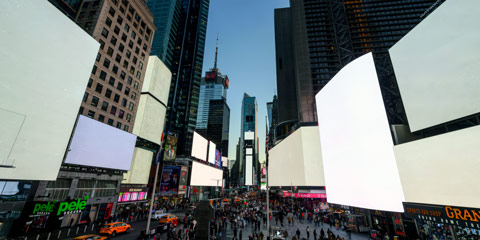

The NYT's headline photo for [the Anthropic IPO](https://www.nytimes.com/2026/11/21/business/anthropic-stock-wall-street-silicon-valley.html) practically writes its own metaphor.

`Figure 1:` **"We Throw Away the Letters, We Only Keep the Weights."** [Shooped](http://shooped.urbanup.com/2675470) from the original photograph "Anthropic advertisements in Times Square on Thursday" by [Karsten Moran for *The New York Times*](https://static01.nyt.com/images/2026/11/20/multimedia/20biz-anthropic-aftermath-cwvh/20biz-anthropic-aftermath-cwvh-superJumbo.jpg).

