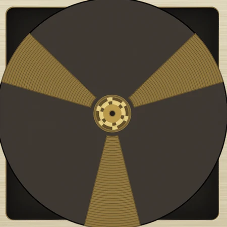
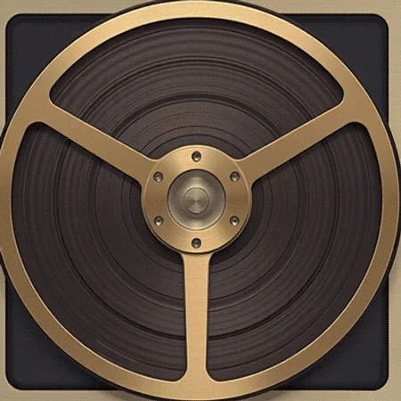

My recent release pace of three web apps and a dataset within the space of a month will likely slow. (If you're looking to hire a rhet-comp PhD who ships, [let me know](contact.html).) Zoe's interface was very much a first draft, and I'd like to give the revised downloadable .zips for the web apps more legibility, so my next few weeks will involve some code refactoring. Part of my revised [development plan](/weblog/2026/11/22/some-notes-on-procedure.html) is to sort the components into file types, and then more substantially comment the functions in the reorganized-by-function code, so for those who download the zips, it's easier to trace the workings: right now, my interaction maps of the load tray's function are a jumbled mess.

Tracing the workings of digital components was part of my duties at *[Kairos](https://kairos.technorhetoric.net)*. While I was there, I toyed with the idea of adapting the journal's [style guide](https://kairos.technorhetoric.net/styleguide.html) and documented internal editorial workflow into a process specification. In terms of pedagogy, the approach above---the mechanics of tracing the workings---is an aspect of technical writing that doesn't get taught much in the course descriptions and assignments I've seen.

Repackaging also lets me revisit the binaries (in bytes, not Elbovian oppositions), which means the drudgery of code refactoring rewards me with bits of pleasant design work. A couple revised binaries, before and after, for which the size should drop as I carve toward release:

**Zoe's return reel:**

`zoe-reel-old.webp` (20Kb)

 `zoe-reel-new.webp` (80Kb)

**Zoe's loop beat:**

<a href="/assets/zoe-old.mp3" aria-label="Play the old loop beat" onclick="new Audio(this.href).play(); return false;">&#9654;&#xFE0E;</a> `zoe-old.mp3` (44.1 kHz mono, 28 kB)

<a href="/assets/zoe-new.mp3" aria-label="Play the new loop beat" onclick="new Audio(this.href).play(); return false;">&#9654;&#xFE0E;</a> `zoe-new.mp3` (44.1 kHz mono, 96 kB)

The drudgery arrives in aligning all the data labels and switches so they do the same thing and make the same calls from instrument to instrument, and figuring out which dependencies are shared: in other words, making elements consistent and legible. In terms of research, such consistency and legibility---and the accompanying measurement replicability these instruments promote---seem to me lately under-examined in writing studies: how many recent empirical studies of composing processes are capable of being re-run to confirm results?
